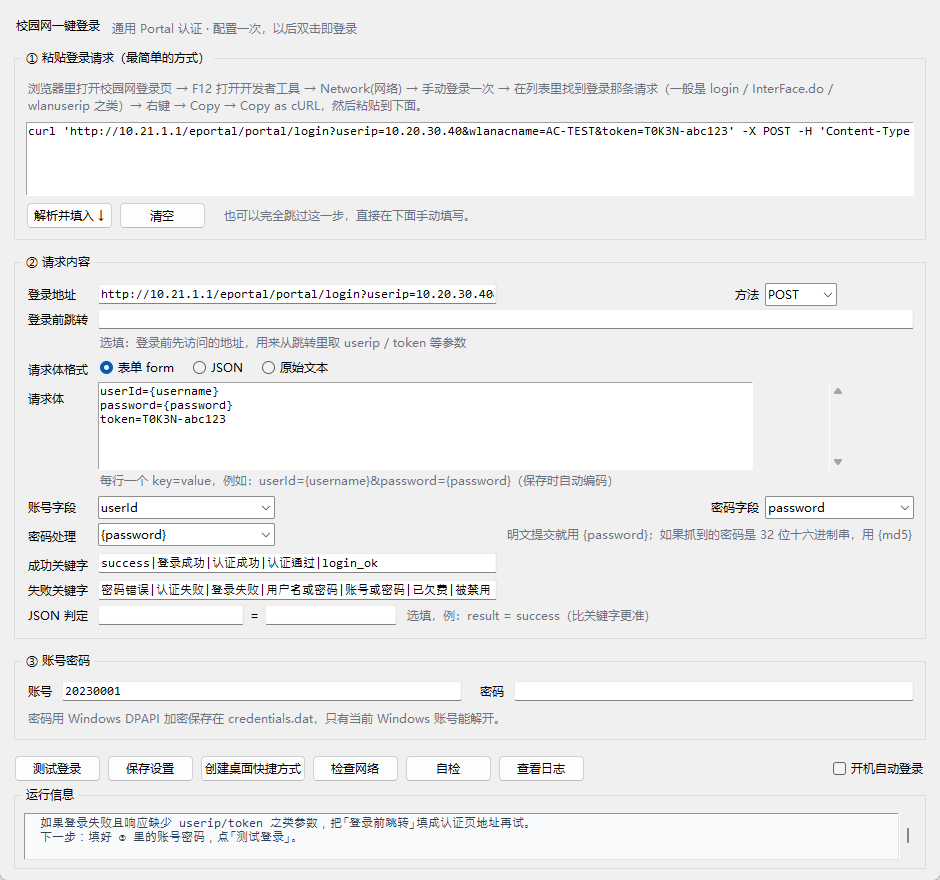

# 校园网一键登录

[](https://github.com/hsqyw86/campus-net-login/actions/workflows/ci.yml)
[](LICENSE)
[](#环境要求)

> 双击一个图标，自动完成校园网网页认证（Portal 登录）。
> 不绑定任何厂商：把你浏览器里那次登录请求「复制粘贴」进来就能用。

一句话原理：**先录下网页登录时发出的那条请求，之后让程序照着重发一遍。**

纯 Python 标准库实现，**不需要 pip 安装任何东西**；账号密码用 Windows DPAPI 加密存在本机。



---

## 为什么它能通用

学校的认证系统五花八门（深澜、锐捷、H3C、华为、城市热点……），但网页认证本质上都是同一件事：

1. 你被重定向到认证页，页面地址里带着 `userip`、`token` 之类的参数；
2. 你点登录，浏览器向服务器 POST 一次（账号、密码、上一步拿到的参数、会话 Cookie）；
3. 服务器返回一段 JSON / HTML 告诉你成功还是失败。

所以程序把「一次登录」拆成四件事，全部用配置描述：

| 阶段 | 做什么 | 配置项 |
| --- | --- | --- |
| 预跳转 | 先访问认证页，从跳转地址里取出本次登录需要的参数、拿到会话 Cookie | `preflight` |
| 发请求 | 按模板拼出 URL / 请求头 / 表单字段，填入账号密码 | `login` |
| 判结果 | 按 JSON 字段或关键字判断成功 / 失败 | `expect` |
| 复核 | 真的能上网了才算成功（可选） | `verify` |

---

## 环境要求

| 项 | 说明 |
| --- | --- |
| 系统 | Windows 10 / 11（用到 DPAPI 加密与注册表自启） |
| Python | 3.10 或更高，**无需 pip 安装任何包**；安装时勾选 `Add python.exe to PATH` |
| 权限 | 不需要管理员权限（开机自启写在 `HKCU` 当前用户下） |
| 找 Python | `.vbs` 启动器会先读 `python_path.txt`，再自动搜索 `%LOCALAPPDATA%\Programs\Python\Python*\pythonw.exe`，所以装到用户目录也能用 |

---

## 三步开始

### 第 1 步：把登录请求抓下来（1 分钟）

1. 电脑连上校园网 Wi-Fi，浏览器会跳出认证页（没跳出就随便打开一个 http 网站，会被劫持过去）。
2. 按 `F12` 打开开发者工具 → 切到 **Network（网络）** 面板 → 勾上 **Preserve log / 保留日志**。
3. 在页面上**手动登录一次**（账号密码正常填）。
4. 在请求列表里找到那条登录请求，一般长这样：
   - `InterFace.do?method=login`
   - `login`、`doLogin`、`/api/login`、`wlanuserip=...`
   
   点它，右侧 **Payload / 载荷** 里能看到 `userId=...&password=...`。
5. **右键这条请求 → Copy → Copy as cURL**（选 `(bash)` 最稳）。

> 抓不到？先确认 Networks 面板没被过滤，或者勾选 `Fetch/XHR` 后再试一次登录。

**想省掉手抄：** 复制完那条 cURL 之后，在项目目录里跑

```bat
python login.py import-curl --save
```

它会直接读剪贴板，写出 `config.json`，并把账号密码从请求里摘出来单独存进 DPAPI
（配置里只留 `{username}` / `{password}`）。不加 `--save` 就是预览，什么都不写。

### 第 2 步：配置（双击 `设置向导.vbs`）

1. 把刚才复制的命令**粘贴到「① 粘贴登录请求」的大框**里 → 点 **解析并填入**。
2. 程序会自动填好登录地址、方法、请求体，并猜出哪个字段是账号、哪个是密码。
   - 如果「账号字段 / 密码字段」下拉框是空的，手动选一下（选完请求体里的值会变成 `{username}` / `{password}` 占位符）。
   - 如果抓到的密码是一串 32 位十六进制，程序会自动把「密码处理」设成 `{md5}`。
3. 在「③ 账号密码」里填真实账号和密码。
4. 点 **测试登录**，下方「运行信息」会显示结果。
5. 成功后点 **保存设置**（密码会加密存储）。

> 配好之后如果哪天登不上，点右下角 **自检**：它会检查 Python、加密存储、配置、请求模板（会真的走一次预跳转取参数）、账号、网络、开机自启，并把问题直接告诉你怎么修。

### 第 3 步：以后就靠双击

- 点 **创建桌面快捷方式** → 桌面出现「校园网一键登录」，以后双击它即可（不弹黑框，成功时右下角飘一条提示）。
- 勾选 **开机自动登录** → 开机连上校园网后自动认证；如果当时不在校园网内，会静默跳过，不打扰你。

---

## 目录结构

```
campus-net-login/
├── 一键登录.vbs            ← 双击这个登录（可建快捷方式）
├── 设置向导.vbs            ← 双击这个改配置
├── setup.pyw               ← 设置向导（图形界面）
├── launcher.pyw            ← 双击启动器（pythonw 跑，无控制台）
├── login.py                ← 命令行入口
├── custom_hook.example.py  ← 需要特殊加密时，复制成 custom_hook.py 再改
├── config.example.json     ← 配置样例（可读，说明字段含义）
├── config.json             ← 你的配置（设置向导生成，不含密码）
├── credentials.dat         ← 账号密码，DPAPI 加密（只有本机本账号能解）
├── state.json              ← 最近一次登录结果
├── python_path.txt         ← 记录 Python 位置，给 .vbs 启动器兜底
├── logs/login.log          ← 运行日志（密码会打码）
├── core/                   ← 核心逻辑
│   ├── portal.py           ← 认证引擎（预跳转 / 组装请求 / 判定 / 重试）
│   ├── curlparse.py        ← cURL 解析
│   ├── importcurl.py       ← 从剪贴板的 cURL 一键生成配置 + 加密凭据
│   ├── secrets.py          ← DPAPI 加密存储
│   ├── autostart.py        ← 开机自启、桌面快捷方式
│   ├── doctor.py           ← 自检（把「为什么登不上」拆成可项检查）
│   ├── runner.py           ← 「已联网就跳过 → 等网关 → 登录」流程
│   ├── config.py           ← 配置读写与校验
│   ├── net.py              ← 联网探测、本机 IP
│   └── paths.py            ← 路径与日志位置
├── gui/setup_app.py        ← 设置向导界面
├── docs/screenshot-setup.png
├── .github/workflows/ci.yml ← 每次提交自动跑 45 项测试
├── tests/                  ← 测试（含本地假认证服务器）
└── LICENSE                 ← MIT
```

整个文件夹可以随便移动 / 拷到 U 盘（`credentials.dat` 换机器就解不开了，需要重新存一次密码）。

---

## 配置项说明

配置文件是 `config.json`，一般不用手改；想知道每一段含义就看 `config.example.json`。

### 可用的占位符

写在 URL、请求头、请求体里都会被替换：

| 占位符 | 含义 |
| --- | --- |
| `{username}` / `{user}` / `{account}` / `{userid}` / `{user_id}` / `{name}` | 账号 |
| `{password}` | 密码（**按 `password_template` 变形后的值**） |
| `{password_raw}` | 明文密码（原样） |
| `{md5}` / `{md5_upper}` / `{sha1}` / `{base64}` / `{urlquote}` | 明文密码的各种变形 |
| `{ip}` / `{local_ip}` / `{userip}` / `{wlanuserip}` | 本机 IP |
| `{mac}` | 本机 MAC |
| `{hostname}` | 计算机名 |
| `{timestamp}` / `{timestamp_s}` / `{date}` | 毫秒时间戳 / 秒时间戳 / 可读时间 |
| 预跳转地址里带的参数 | 比如地址里有 `?userip=1.2.3.4&token=abc`，就能直接用 `{userip}`、`{token}` |

> 写错占位符会直接报错并列出所有可用变量，不会发出半截请求。

### 密码怎么变形：`login.password_template`

| 学校密码字段长这样 | 填这个 |
| --- | --- |
| 明文（最常见） | `{password}`（默认） |
| 32 位小写十六进制 | `{md5}` |
| 大写 md5 | `{md5_upper}` |
| Base64 | `{base64}` |
| 固定前缀 + md5 | `{MD5}{md5}` 这类写法也支持（前缀原样保留） |
| 都不是 | 用 `custom_hook.py`（见下文） |

### 判定成功 / 失败：`expect`

按优先级：

1. 填了 `json_path` + `json_equals`（例：`result` = `success`）→ 只看 JSON 字段；
2. 否则先看 `failure_keywords`（命中即失败），再看 `success_keywords`（命中即成功）；
3. 都不匹配但 HTTP 200 → 交给 `verify` 联网探测定夺。

关键字用 `|` 分隔，在设置向导里直接填一行即可。

### 其它

| 配置 | 作用 |
| --- | --- |
| `preflight.url` | 登录前先访问的地址（通常是认证页首页），用来取参数 / 拿 Cookie |
| `preflight.capture_regex` | 参数在响应正文里时用正则提取：`[{"name":"token","pattern":"token=([0-9a-f]+)","from":"body"}]` |
| `login.auto_referer` | 自动带上 `Referer`（默认开，很多服务器要） |
| `login.escape_form` | 原始文本请求体里，账号密码做 URL 编码（默认开） |
| `login.insecure_tls` | 认证页是自签名 HTTPS 时设为 `true` |
| `verify.url` / `verify.expect_status` | 联网复核用的地址，默认 `generate_204` → 期望 204 |
| `retry.attempts` / `interval` / `max_interval` | 失败重试次数 / 首次间隔秒数 / 退避上限（默认 30，间隔按 2× 翻倍，带 ±15% 抖动） |
| `network.wait_timeout` | 开机自启时等校园网就绪的最长秒数（默认 90） |
| `ui.notify_on_success` | 手动双击登录成功后右下角飘一条提示（默认开；开机自启带 `--quiet`，不会弹） |
| `ui.notify_on_failure` | 登录失败时弹窗说明原因，并给一个「打开设置向导」的按钮（默认开） |

---

## 常见认证系统对照

| 系统 | 典型特征 | 提示 |
| --- | --- | --- |
| 深澜 Dr.COM | 地址含 `InterFace.do?method=login`、字段有 `userId`/`password`/`service`/`queryString` | `queryString` 一般是登录页的整段参数，可用预跳转 + `capture_regex` 提取；密码若被 JS 加密需 `custom_hook.py` |
| 锐捷 Ruijie ePortal | 地址含 `/eportal/`，字段有 `userId`/`password`/`service`，密码多为 `{SRUN2}` 之类前缀串 | 密码形如 `{SRUN2}xxxx` 时必须用 `custom_hook.py` 复现算法 |
| H3C / 华为 | 表单字段常见 `userip`/`wlanuserip`/`nasip`/`userpass` | 这些参数多半在登录页 URL 里，靠预跳转自动取 |
| 城市热点 / 其它 | 跳转地址带 `wlanacname`、`nasip`，登录接口像 `/login` | 用 cURL 导入后看「测试登录」的报错再微调 |

**以上只是线索，最终以你抓到的请求为准。** 抓包 → 粘贴 → 测试，是唯一可靠的路径。

---

## 命令行用法

```bat
python login.py                     :: 登录一次
python login.py login --wait        :: 先等校园网就绪再登录（开机自启就是这么跑的）
python login.py login --force       :: 即使已联网也强制重新登录
python login.py check               :: 看配置是否完整、当前是否已联网
python login.py preview             :: 打印将要发出的请求（密码打码）
python login.py set-credentials     :: 交互式重存账号密码
python login.py autostart on|off|status
python login.py doctor              :: 自检（加密、配置、模板、网络）
python login.py doctor --no-network :: 自检但不联网（离线时用）
python login.py log                 :: 看最近 40 行日志（双击启动时没控制台，出问题用这个）
python login.py log -n 200          :: 看最后 200 行
python login.py import-curl         :: 从剪贴板的 cURL 预览导入结果（不落盘）
python login.py import-curl --save  :: 直接写入 config.json + 加密凭据
```

退出码：`0` 成功或已联网 / `1` 登录失败 / `2` 配置或账号问题 / `3` 网络未就绪。

---

## 自检：登不上时先跑这个

图形界面的 **自检** 按钮和 `python login.py doctor` 是同一套检查，逐项告诉你卡在哪：

```
=== 自检 ===
Python：✓ 3.14.0  (C:\Users\you\AppData\Local\Programs\Python\Python314\python.exe)
DPAPI 加密存取：✓ 正常
配置文件：✓ config.json
请求模板渲染：✓ POST http://10.21.1.1/eportal/InterFace.do?method=login
已保存账号：✓ 20***
联网探测：✓ 已联网
开机自启：未开启
日志文件：C:\...\campus-net-login\logs\login.log
=== 自检通过 ===
```

其中**请求模板渲染**会真的走一次「预跳转」，所以能提前暴露「`{token}` 取不到」「认证页打不开」这类问题——
如果只是当前不在校园网内，它只标成提示而不会误报成配置错误。账号只显示前两位，日志里也不会有密码。

有任何一项是 `✗` 时，末尾会列出「自检发现问题（N 项）」，每条都带修复建议，退出码为 `1`。

---

## 特殊加密：custom_hook.py

如果抓到的密码是一串看不懂的密文（不是明文、也不是单纯 md5），说明网页 JS 做了加密：

```bat
copy custom_hook.example.py custom_hook.py
```

然后在 `custom_hook.py` 里实现：

```python
def transform_password(username, password, variables) -> str:
    ...
    return 加密后的字符串
```

找算法的办法：开发者工具 → Sources → 搜 `password` / `encrypt` / `AES`，找到加密函数，把 key、iv、填充方式照抄过来（AES 需要 `pip install pycryptodome`）。

也可以实现 `judge(status, body, expect)` 来自定义成功判定。

---

## 安全说明

- 密码用 **Windows DPAPI** 加密存在 `credentials.dat`，密钥由系统按「当前 Windows 账号」管理：
  同一台电脑换个 Windows 账号、或把文件拷到别的电脑，都解不开。
- `config.json` 里**不含密码**，只有 `{password}` 占位符；设置向导还会拦住「请求体里留着明文密码」的保存。
- 日志 `logs/login.log` 会记录请求过程，但密码、Cookie、token 都打了码。
- 程序只向**你配置的校园网地址**发请求，不做任何上报、不连第三方（联网探测只有 204 那个可选请求）。
- 想彻底清除：删掉 `credentials.dat` 即可。

---

## 故障排查

| 现象 | 原因 / 解决 |
| --- | --- |
| 提示「占位符 {xxx} 不认识」 | 配置里写了不存在的变量；报错信息会列出全部可用变量 |
| 登录返回「无会话 / token 无效」 | 缺预跳转：把认证页地址填到「登录前跳转」，让它先取 Cookie 和参数 |
| 提示「密码错误」但网页能登录 | 密码不是明文提交的：确认「密码处理」是否该用 `{md5}`；仍不行就上 `custom_hook.py` |
| 登录返回成功但提示联网没通过 | `verify` 地址被学校拦了：把它改成 `http://www.baidu.com` 并把期望状态改成 `200`，或直接关掉 `verify.enabled` |
| 双击没反应 | 看 `logs/login.log`，或直接在终端跑 `python login.py log`（双击启动没有控制台，日志是唯一现场） |
| 提示「配置文件不是合法 JSON」 | 手改过 `config.json`：多半是记事本存成了 ANSI/GBK。用 UTF-8 保存，或直接让设置向导重存一次 |
| 开机没自动登录 | `python login.py autostart status` 看是否写入；若被组策略限制，会退化到「启动」文件夹里的快捷方式 |
| 每次都要重新登录 | 校园网本身有会话时长限制；可把 `retry` 用在计划任务里定时跑（本工具默认只做「一次登录」） |

失败时命令行和弹窗都会多给一句**提示**（例如「连不上网关」「网关直接拒了这次请求」「接口说过了但实际没网」）。
它只在能确定方向时才出现——猜错方向的建议比没有建议更坏，所以拿不准时它会只说「网关的原话是……」，把判断权留给你。

---

## 测试

```bat
python tests\run_tests.py     :: 45 项：cURL 解析、模板、加密、判定、退避重试、自检、启动器编码、零依赖、端到端登录（本地假服务器）
python tests\gui_smoke.py     :: 界面冒烟：控件、布局、cURL 导入、明文拦截
python tests\mock_portal.py 8099   :: 单独起一个假认证服务器手动玩
```

`tests/mock_portal.py` 是一个模拟的 Portal 认证服务器（预跳转下发 Cookie 和 token、校验 md5 密码、返回 JSON），
端到端测试就是拿它跑通的，不需要真的连校园网。

GitHub Actions（`.github/workflows/ci.yml`）会在每次提交时用 Python 3.10 / 3.11 / 3.12 / 3.13 各跑一遍：语法编译 → 45 项测试 → 命令行冒烟（拿 `config.example.json` 跑真实的 `preview` / `check` / `doctor`）。

---

## 已知限制

- 只覆盖**网页 Portal 认证**；802.1X 认证、必须装客户端（如 Dr.COM 客户端 / 锐捷客户端）的场景不适用。
- 登录页带**图形验证码**的用不了（需要识别验证码，本工具不做）。
- 学校强制改密码、或密码策略变化后，需要重新保存密码。
- 默认只做「一次登录」，没有做「断网自动重连」的常驻监控（想加的话，把 `login.py login --force` 丢进任务计划程序每 10 分钟跑一次即可）。
- **非中文的 Windows（英文等）** 上，系统的 `WScript.Shell` 会把快捷方式里的中文路径写成 `????`：本工具已尽量兼容（创建失败会自动退回 ASCII 文件名），但若桌面/启动文件夹里的快捷方式指向了 `????.vbs`，请手动把「一键登录.vbs」拖到桌面建立快捷方式（或在资源管理器里右键 → 发送到 → 桌面快捷方式）。中文 Windows 不受影响。

---

## 参与

- 想让工具支持你们学校那套认证：先试 `custom_hook.py`，实在不行再动核心，别往核心里塞 if。
- 提问题请带上 `python login.py doctor` 的输出，以及**把值换成 x** 的登录请求；细节见 [CONTRIBUTING.md](CONTRIBUTING.md)。
- 「只用 Python 标准库」是硬约束，PR 请守住。

许可：[MIT](LICENSE)。

---

## English

One-click campus network (captive portal) login for Windows — vendor-agnostic.

Record the login request your browser sends (DevTools → Network → right-click → *Copy as cURL*), paste it into the setup
wizard, and the tool replays it on demand: preflight redirect (to harvest `userip` / `token` / session cookies), login POST,
JSON or keyword verdict, optional connectivity check. Credentials are encrypted with Windows DPAPI (per Windows account,
machine-bound). Add a desktop shortcut or autostart and it just works.

Pure Python 3.10+ standard library — no `pip install`, no admin rights. MIT licensed.

Contributions welcome — see [CONTRIBUTING.md](CONTRIBUTING.md).
